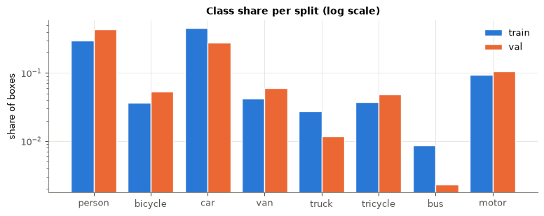
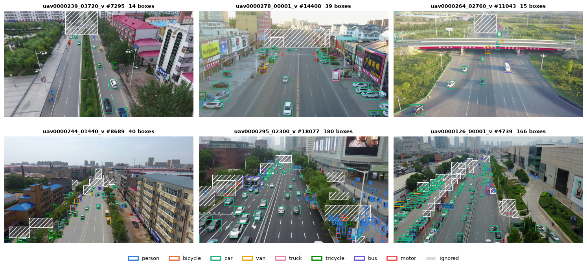
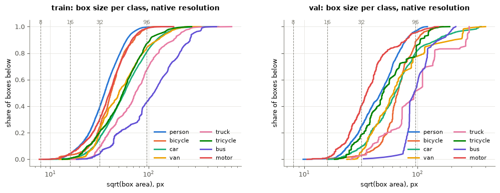
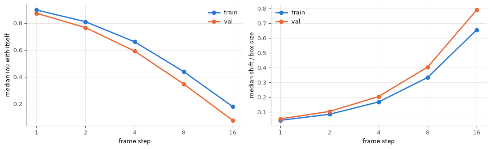
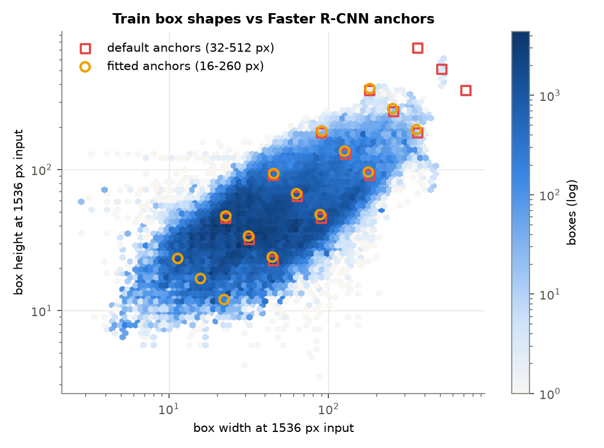
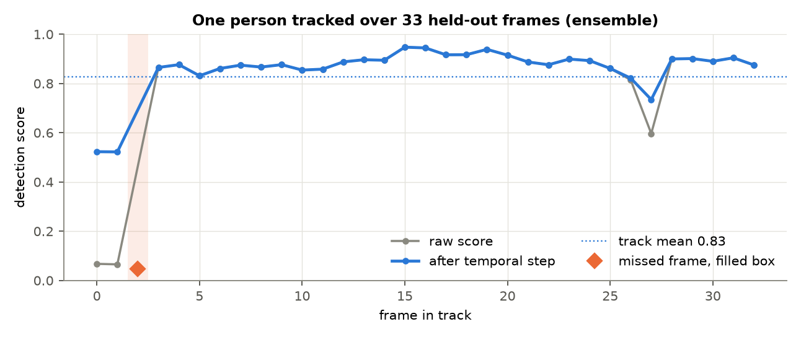

## Introduction

this is a report on the second homework of the UCU.AI course, main goal of which was to write a DL model that is capable of predicting certain objects in a video

## EDA and findings

before doing any actual training we did a data analysis on the dataset.

First, on the actual dataset. Train is 56 clips and 24000 frames, while val is only 7 clips with almost 3k frames in total. Test clips are shorter: 3800 frames for 48 clips, meaning every test clip is a short part of a video. Train dataset has over a million boxes, validation has over 100k of them. Train is mostly 1904x1071, 1344x756 and 2688x1512, while test is mostly 1360x764 and 1920x1080 and also has 680x382 and 960x540, which are not in train at all. So the model had to work on different scales, and it made sense to use scale augmentation



There are 8 classes in total: person, bicycle, train, car, van, truck, tricycle, bus and motor. On average there are ~50 objects per frame, up to 180 at most. Car (46%) and person (30%) are most of train, while bus is under 1% and truck under 3%, so the classes are very imbalanced. Val has a different mix: person is 44% and car only 28%, because with 7 clips a couple of people-only clips change everything, this meant we should make our own val split by clips so that the class mix would be checked and not left to chance



also a good thing to pinpoint was the object size: at native resolution 25% of train boxes were under 32 px, and person, bicycle and motor were the smallest. So the default 640 input of yolo loses about half of the objects, and the input should be at least 1280 or the frame had to be cut into tiles. person boxes are tall, cars are wide while rest were close to squares.



main decisions from eda:  input of at least 1280 on the long side or tiles, with scale augmentation because test comes in resolutions that train does not have. Anchors for faster r-cnn and retinanet from kmeans instead of the defaults. Train on every 3rd-5th frame, since neighbouring frames are almost the same. Ignored regions masked out in training, nms per class, and our own val split made by clips with a class mix close to train


## Preprocessing

for the preprocessing part we decided on a few things. The first from EDA is frame resizing to a fixed 1536px, also from there is the decision to train on every 4th frame. labels are mapped to 0-7, and already merge with some visdrone classes. Ignored regions are filled with grey in training (not in evaluation though), and any ground truth box with the center inside is dropped. This is done so the model does not learn to treat unlabeled objects there as background. we also normalise pixels to 0-1, and torchvision models also need further normalisation subtracting the mean and std. 



Augmentation: scale jitter (0.75 to 1.25), degrade 20% of frames by blurring them, object-focused crops, horizontal flips with p = 0.5 to double the variety for free and brightness/contrast changes by +- 20% 

## Faster R-CNN

rcnn and retinanet are the two torchvision models. It works in two stages:

1. the RPN: slide over the feature maps, and at each position we place a few anchors (template boxes of fixed sizes and shapes) and ask two things: is there an object here, and how should the anchor be shifted to fit it. The best 1,000 anchors become proposals
2. the RoI head: we cut out the features of each proposal (RoIAlign), then classifi it into 8 classes or background and refine the box again

our model uses COCO-pretrained weights and the final classifier is replaced with a 9-way one with background beside the 8 standart classes. Training: 12 epochs, batch size 4 of 800 px crops, Stochastic Gradient Descent with learning rate 0.01, momentum 0.9 and a small weight decay as a regularization penalty.



| Run | Change | mAP | AP50 | AP75 | AP_small | AR500 | fps |
|---|---|---|---|---|---|---|---|
| frcnn_base | default anchors | 0.291 | 0.523 | 0.282 | 0.101 | 0.455 | 8.1 |
| frcnn_anchors | fitted anchors | 0.291 | 0.528 | 0.285 | 0.120 | 0.467 | 8.1 |
| frcnn_roi | fitted anchors, RoI batch 256, positive fraction 0.5 | 0.285 | 0.524 | 0.276 | 0.108 | 0.469 | 9.3 |

## RetinaNet

How it works - classification and box regression run directly on every anchor at every position, about 100k anchors per image, with no proposal step in between. Almost all of those anchors are background. A plain loss would be swamped by easy background example,so we use focal loss

for our setup we use basically the same pipeline as rcnn, as for focal loss alpha is 0.5 and gamma is 2. 

| Run | Change | mAP | AP50 | AP75 | AP_small | AR500 | fps |
|---|---|---|---|---|---|---|---|
| retinanet_base | default anchors | 0.263 | 0.459 | 0.270 | 0.087 | 0.380 | 10.3 |
| retinanet_anchors | fitted anchors | 0.256 | 0.502 | 0.234 | 0.109 | 0.437 | 11.3 |
| retinanet_assign | fitted anchors, IoU fg 0.4 / bg 0.3 | 0.250 | 0.478 | 0.237 | 0.106 | 0.405 | 10.7 |
| frcnn_anchors | tuned two-stage, for comparison | 0.291 | 0.528 | 0.285 | 0.120 | 0.467 | 8.1 |

## YOLO
  
we use yolo26s from ultralitycs with COCO weights and 10M params. No anchors are used, and every cell of P3/P4/P5 grids predicts its distance to the four boxes directly, instead the candidates for a GT box are the grid points whose centre falls inside that box, each candidate is scored and  a location wins if it both classifies and localises the object well.The top 10 candidates become positives.

Training: 60 epochs, batch 8, cosine learning rate, ultralytics' automatic optimizer choice. evaluation is our own just like for every other model

| Run | Change | mAP | AP50 | AP75 | AP_small | AR500 | fps |
|---|---|---|---|---|---|---|---|
| yolo_noaug | 640, augmentation off | 0.204 | 0.367 | 0.203 | 0.060 | 0.306 | 23.1 |
| yolo_base | 640 | 0.214 | 0.380 | 0.216 | 0.064 | 0.308 | 24.0 |
| yolo_1280 | train 1280, predict 1536 | 0.256 | 0.450 | 0.258 | 0.096 | 0.366 | 19.0 |
| yolo_p2 | 1280 / 1536, P2 head | 0.251 | 0.447 | 0.250 | 0.097 | 0.371 | 17.9 |

## RT-DETR

RT-DETR (`rtdetr-l`, ultralytics) is configured in `configs/rtdetr.yaml` (train 1024, predict 1280, 40 epochs, AdamW lr 1e-4, batch 4) but was never trained,as it was last in the training queue and the Kaggle sessions always stopped before it got to run

## Our pipeline

Previous results showed that frcnn is the most accurate model, and the per-class table shows that YOLO actually has different mistakes than RCNN. also helps that yolo is pretty fast, so we decided to combine these two models into our own pipeline.

there are six passes per frame: FRCNN, normal and flipped with weight 2 each, and YOLO at 2 diff resolutions each normal and flipped, so each model contributes with a weight of 2. Then using weighted box fusion we combine the passes that overlap at IoU > 0.6 and keep the top 500 scoring per frame. 

Then we also added a temporal step: first we link boxes across frames to get tracks, with an idea that long tracks raise weak scores while short ones do the opposite. basically if an object is clearly visible in most frames a weak detection in one frame is probably real, and the other way around. This actually boosted our results by a bit



| Setup | mAP | AP50 | AP75 | AP_small | AR500 | fps |
|---|---|---|---|---|---|---|
| frcnn_anchors | 0.291 | 0.528 | 0.285 | 0.120 | 0.467 | 8.1 |
| frcnn_anchors + temporal (alpha 0.4) | 0.293 | 0.532 | 0.288 | 0.122 | 0.468 | |
| ensemble (frcnn_anchors + yolo_1280) | 0.320 | 0.567 | 0.322 | 0.134 | 0.499 | 2.2 |
| ensemble + temporal (alpha 0.4) | 0.322 | 0.569 | 0.325 | 0.134 | 0.499 | |

## Final model and how to run it

Final model: ensemble of `frcnn_anchors` and `yolo_1280` with temporal rescoring (alpha 0.4).

```bash
pip install -r requirements.txt
pip install -e .
python scripts/download.py
python scripts/split.py
```

```bash
python scripts/train.py configs/frcnn.yaml --name frcnn_anchors --set anchors=fit
python scripts/train.py configs/yolo.yaml --name yolo_1280
```

```bash
python scripts/evaluate.py configs/ensemble.yaml --temporal alpha=0.4
python scripts/predict.py configs/ensemble.yaml --temporal alpha=0.4 --out submission.csv
```

```bash
bash run.sh
bash run_t4.sh
```

`run.sh` runs every experiment on one GPU, `run_t4.sh` splits them over 2 GPUs (Kaggle 2x T4, `notebooks/kaggle.ipynb`). `HW2_DATA` can point to an existing copy of the competition data. Seed 0 everywhere, configs in `configs/`, held-out clips in `splits/holdout.json`.

## Results

 Final result: 0.322 on held-out, ~0.300 on the public leaderboard (not private yet though)

## Conclusion

- YOLO is the fastest but least accurate approach, RCNN is the slowest and most accurate, and RetinaNet is somewhere in-between. 
- Combining models beat parameter tuning, as the ensemble of Faster R-CNN and YOLO reached 0.320 on held-out, against 0.291 for the best single model. 
- Additional algorithms can boost scores, like we did with temporal smoothing
- a lot of time is needed for training of cv dl models